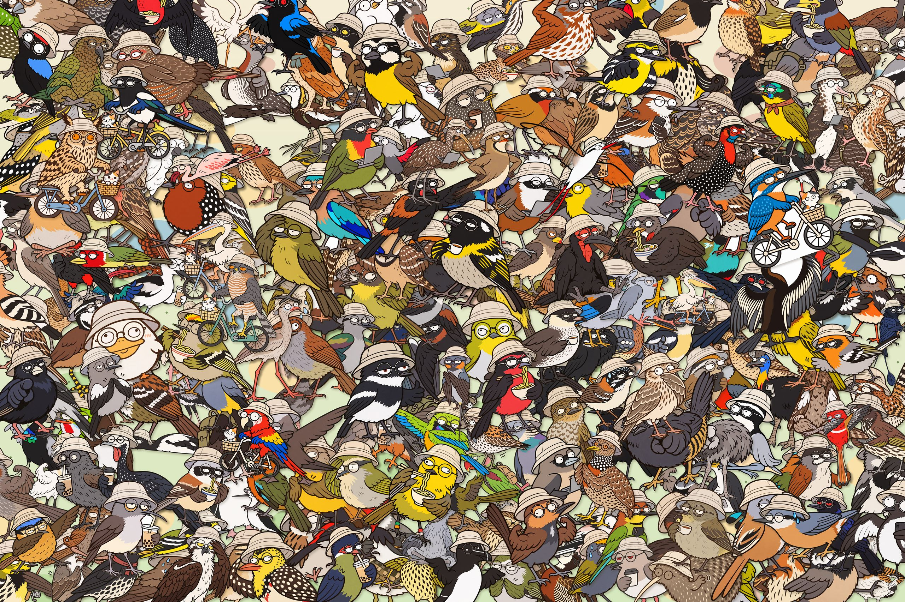

# 全球鸟类贴纸库（AI Native 分支）

[English](README.md) · **简体中文**

**这套贴纸的完整精神状态，不用去别的网站看，往下滑就懂了。**



原作者在 [`huashu-bird-sticker`](https://github.com/alchaincyf/huashu-bird-sticker) 里开源了 11,064 种 AI 生成的鸟类贴纸，覆盖了地球上全部现生物种。同时，原仓库在授权里立下了规矩：贴纸随便用（含商用），唯独不能拿去做观鸟、识鸟或鸟类图鉴类的竞品；物种数据部分则走 MIT 协议。

**好的。**

为了响应「带着自己的认知和审美，去把 AI 工具利用好，生产出更有价值的东西」的时代号召，我们决定严格遵守原仓库的 MIT 数据协议，从名单里请出 249 种鸟，**不搬运原项目的一像素一羽毛**，全部用 AI 重新绘制。

既然在 AI 批量生成的工业浪潮里，初级飞羽有几根、脚趾朝哪边长已经不再是困扰人类的问题，我们索性帮这 249 只鸟彻底卸下了自然演化的包袱——统一配发渔夫帽、圆眼镜，并注入同款空荡荡的眼神。此外，我们还顺手帮这个世界补全了第 250 个全新物种：**`huachu bird`**（是的，我们把它也写进图鉴了）。

**授权一句话：** 贴纸可以免费用于任何用途，包括商用、修改、自嘲和斗图；**唯一不行的是拿去做观鸟、识鸟或鸟类图鉴类的 App、网站或服务。**

当然，我们本来也不是——严肃的博物学图鉴里哪有全员戴渔夫帽的。像素本人已与严肃生物学、野外识别、保护等级彻底脱钩。想认鸟、查分布，请去翻图鉴；想看一万只 AI 鸟如何整齐划一地填满名录，请去原项目；想找谁在骑车、谁在发呆、谁在思考如何安身立命，欢迎来这。

## 画廊

原项目致力于「尽量挑彼此长得不一样的」，而我们致力于探索 AI 的另一重境界：**在跨目、跨科的巨大演化鸿沟面前，保持绝对一致的体面。** 这里展示的都是 100% 达到我们质量线的贴纸。

### 骑行类 · *Bicycliformes* — 6种

涵盖翠鸟、喜鹊、雕鸮、金刚鹦鹉、鹈鹕、雀鹰。在漫长的演化史中，这六个物种率先顿悟：扇动翅膀只会带来毫无意义的空气阻力，唯有蹬起脚踏车，才能稳稳驶向属于自己的时代价值。车筐标配一只可补光的小猫——野外摄影需要补光灯，本图鉴选择了更有生命力的方案。

### 凝视类 · *Stareiformes* — 243种

摘下望远镜，戴上圆眼镜。当 243 个物种用同一副空荡荡的表情与你对视，分类学上的一切分歧都得到了和解。至于帽檐底下原本长着什么样的眉纹与嘴峰，那重要吗？反正生成管线也不在乎。

### 冠名类 · *Huachuformes* — 1种

**本库特有种：`huachu bird`。**

无危（LC），甚至可以说是极度繁荣。广泛栖息于各大内容社区与代码仓库，擅长在不需要画笔的情况下，为人类画师指明未来的方向。

## 里面有什么

| 路径 | 内容说明 |
| --- | --- |
| `birds/*.png` | 243 张凝视类贴纸，全员渔夫帽、圆眼镜、情绪稳定 |
| `birds/003.png` … `008.png` | 6 张突破鸟类骨骼力学极限的骑自行车特供版（同种替换） |
| `easter/huachu-bike.png` | 图鉴收官藏品 / 骑行精神图腾（鹈鹕款，车筐有补光小猫） |
| `collage/` | Where’s Wally 风格大图与彩蛋坐标 |
| `manifest.json` | 继承自原仓库精神的物种名录。名字还是那些名字，灵魂已经换了 |

## 覆盖情况

* **物种名录：** 249 种自然界现存鸟类 + 1 种赛博特有种（`huachu bird`），共 250 种，一种不缺。
* **护具配发率：** 渔夫帽 100%，圆眼镜 100%。
* **载具配发率：** 自行车覆盖率约 2.4%（其余目前仍处于步行或发呆状态）。
* **野外识别准确率：** 0%。我们坦诚地交出了零分答卷，绝不让任何一位观鸟新手产生「拿这套图就能去林子里认鸟」的错觉。

## 贴纸怎么来的，质量如何

250 张全部由 AI 重新绘制。我们没有因为找不到照片去拼凑参考板，也没有让审核员拿着放大镜去数画对了几个脚趾。

每张贴纸生成后，由审核员对照四项核心指标进行严苛打分：**帽檐的垂坠感、镜框的圆润度、眼神的放空率、以及扶车把的松弛感。**

* **250 张全部达到我们的质量线**（`"meetsQualityBar": true`）：得分全部在 100 分以上。
* **0 张没有达到。** 我们没有遇到「重画到次数上限依然不及格、但为了凑齐图鉴只好把及格线以下的图也硬留下来」的遗憾。毕竟只要审美标准足够统一，流水线就永远不会画错。

这些是表情包，不是科普图版。当作一张友好的赛博幽默来用；涉及细节辨识，请把专业的事交还给真正的博物学画师与野外摄影师。发现哪只鸟眼神不够空洞，欢迎开 issue。

## 参考照片与致谢

本仓库的所有贴纸均未参考任何自然生态摄影师的实拍照片。因此，摄影师朋友们无需特意发邮件申请「7 天内替换或撤下」——自然界的版权属于你们，我们只负责生产渔夫帽。

```bash
git clone https://github.com/nagi-studio/huachu-bird-sticker.git
```

* **数据致谢：** 物种清单源自 [`alchaincyf/huashu-bird-sticker`](https://github.com/alchaincyf/huashu-bird-sticker)（数据 MIT）。
* **合规声明：** 原项目贴纸受 PolyForm Shield 1.0.0 保护，禁止用于观鸟/识鸟竞品。本项目一未用原图，二全员戴帽骑车，从法理到生物学均已彻底排除成为竞品的可能。
* **灵感缪斯：** 感谢原作者关于「认知与审美」的公开探讨。希望这 250 顶渔夫帽，没有辜负这个时代。

## Website

[huashu.dog](https://huashu.dog) — 观鸟 + Where's Huachu。静态站点在 `site/`。**观鸟**浏览全部 249 张贴纸；**Where's Huachu** 每一局把贴纸重新铺开，目标始终是较小的 `easter/huachu-bike.png`。

音效是 Kenney Interface Sounds（CC0）。画廊、寻鸟、庆祝分别用 PhotoSwipe、PixiJS、canvas-confetti。
